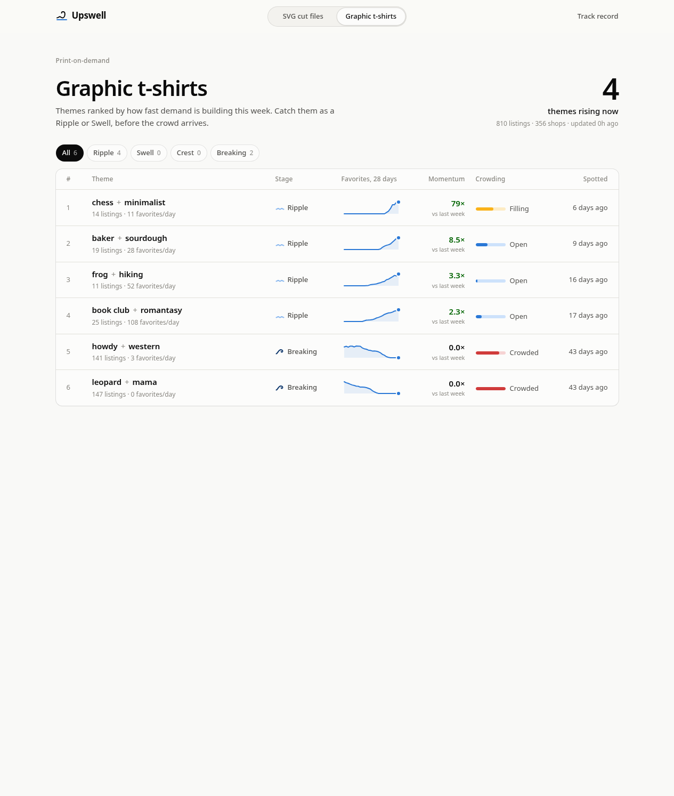
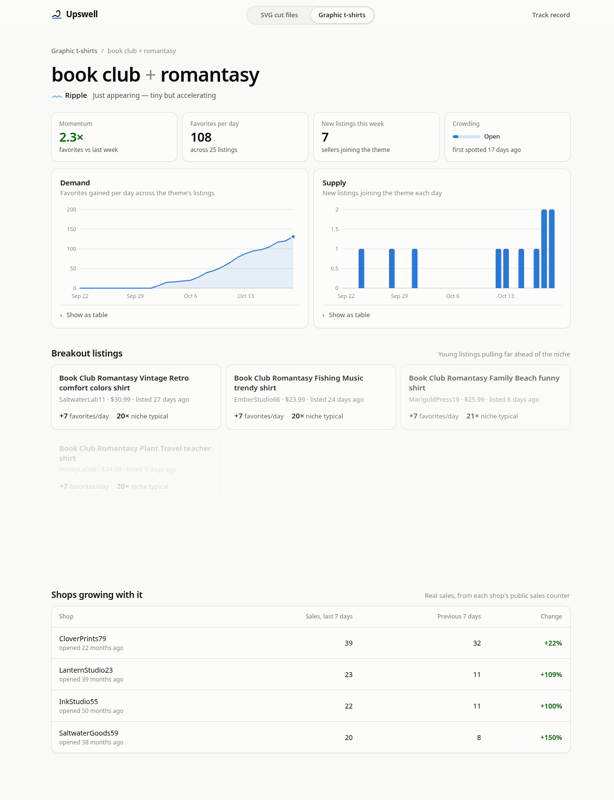

# Upswell

Trend insights for Etsy sellers: which product themes are gaining buyer interest in a
niche, spotted before they get crowded.

- **Read-only.** Uses public listing and shop statistics from the Etsy Open API
  (favorites, views, public sales counts). No private data, no write access.
- **No scraping, ever.** Data comes only through official APIs, within their limits.
- **Themes, not copied listings.** Sellers see which ideas are rising, never other
  shops' photos or descriptions. The point is to help sellers make original work for
  real demand.
- **Short retention.** Raw statistics are kept briefly; only aggregate trend history
  is stored long term. See the [privacy policy](PRIVACY.md).

_Screenshots show the research dashboard running on simulated data._

**Status:** private research prototype, built by an independent Etsy seller.

---

The term "Etsy" is a trademark of Etsy, Inc. This application uses the Etsy API but is
not endorsed or certified by Etsy, Inc.
