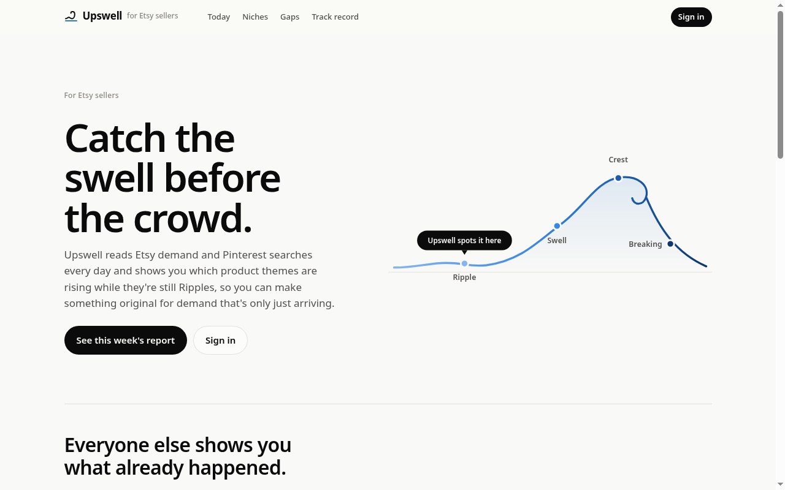
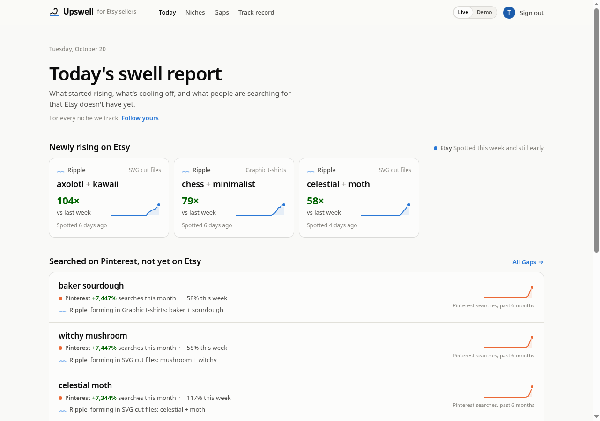
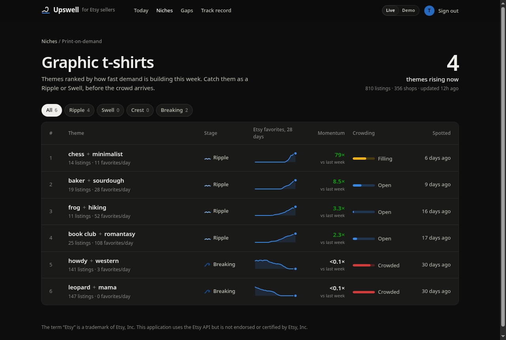
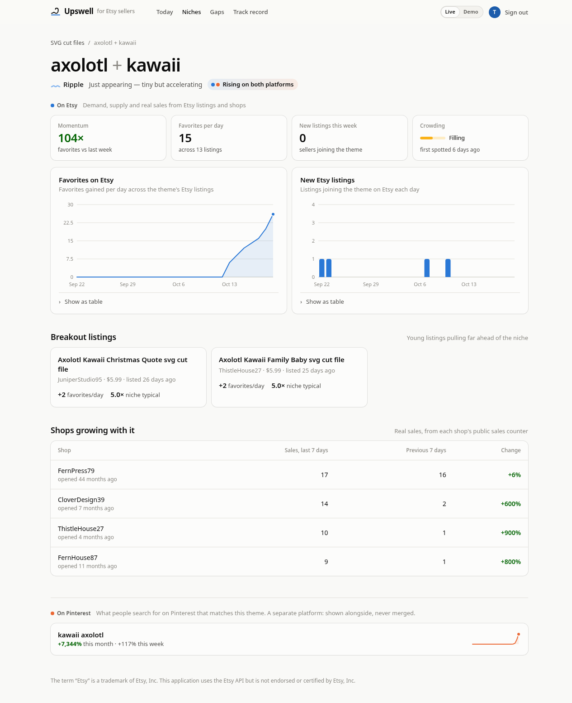

  

<h1 align="center">Upswell</h1>

  <strong>Catch the swell before the crowd.</strong> 
  Trend insights for Etsy sellers: which product themes are rising while they're still early.

  <a href="https://2styx2.github.io/upswell/">Website</a> ·
  <a href="https://2styx2.github.io/upswell/privacy/">Privacy policy</a> ·
  <a href="https://github.com/2styx2/upswell/issues">Contact</a>

  

---

## Why

Etsy shows you what exists. Pinterest shows you what inspires. Keyword tools show you what you
already thought to ask about. None of them tell you **what's rising, and how early you are**.

Upswell lines up Etsy demand and Pinterest searches in time and gives every product Theme a
**Stage**, so a seller knows whether to start making now or move on:

| Stage | What it means | What to do |
|---|---|---|
| **Ripple** | Tiny but accelerating | Make now |
| **Swell** | Rising fast, not crowded yet | Still room |
| **Crest** | Near its peak, competition arriving | Be quick |
| **Breaking** | Crowded or fading | Move on |

## How it works

1. **Read.** Once a day, Upswell reads public Etsy statistics (favorites, views, shops' public sales
   counts) and trending search keywords from Pinterest, through their official APIs.
2. **Spot.** Listings group into Themes by the tags they share. Each Theme gets a momentum, a
   crowding level and a Stage.
3. **Act.** Sellers open a daily report: new Ripples, Gaps (searched on Pinterest, not yet on Etsy)
   and the evidence behind each one.

Etsy and Pinterest are **kept apart**: each platform is its own signal, in its own colour. Only when
both rise together is a Theme labelled *Rising on both platforms*.

## Screenshots

<table>
  <tr>
    <td width="50%"> <b>Today.</b> New Ripples on Etsy, and Pinterest searches Etsy doesn't serve yet.</td>
    <td width="50%"> <b>A niche.</b> Themes ranked by momentum, with Stage and crowding. Dark mode.</td>
  </tr>
  <tr>
    <td colspan="2"> <b>A Theme.</b> The evidence, split by platform: Etsy favorites, breakout listings and crowding, then Pinterest searches.</td>
  </tr>
</table>

_All screenshots show the research dashboard running on **simulated data**. No numbers here are real results._

## Principles

- **Read-only.** Uses public, aggregate statistics from the Etsy Open API and the Pinterest Trends
  API. No private shop data, no user data, no write access.
- **No scraping, ever.** Data comes only through official APIs, within their limits.
- **Themes, not copied listings.** Sellers see which ideas are rising, never other shops' photos or
  descriptions. The point is to make original work for real demand.
- **Short retention.** Raw statistics are kept briefly; only aggregate trend history is stored long
  term. See the [privacy policy](PRIVACY.md).
- **An honest track record.** Every Theme Upswell flags is logged and checked later, so the hit rate
  can't be cherry-picked.

## Status

**Research preview.** Built by an independent Etsy seller and being tested privately before any
public launch. A paid plan (about $10 a month) is planned once the signals prove themselves.

This repository holds the public website and policies; the application code is private.

---

The term "Etsy" is a trademark of Etsy, Inc. This application uses the Etsy API but is not
endorsed or certified by Etsy, Inc. Pinterest is a trademark of Pinterest, Inc. Upswell is not
affiliated with or endorsed by Pinterest.
